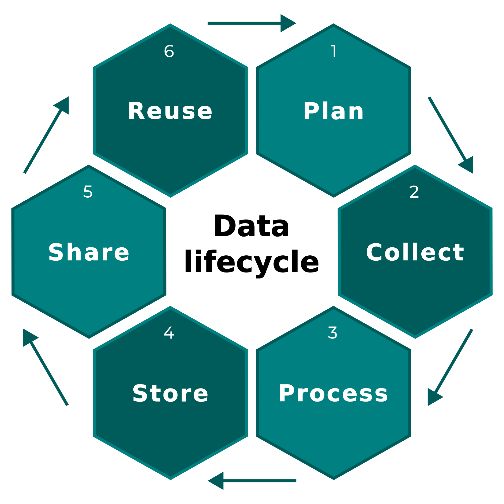

# Welcome {.unnumbered}

::: {.callout-note}
## Registration to the training course

Registrations open each spring and the training course takes place during fall. 
More information is available on the [FRB-CESAB website](https://www.fondationbiodiversite.fr/en/the-frb-in-action/programs-and-projects/le-cesab/develop-skills/la_donnee_en_biodiversite/).

&nbsp; Subscribe to the 
[FRB-CESAB newsletter](https://www.fondationbiodiversite.fr/en/newsletter/) 
to stay informed. 
:::


This five-day training course, co-organized by the [FRB-CESAB](https://www.fondationbiodiversite.fr/en/about-the-foundation/le-cesab/), the [PNDB](https://www.pndb.fr/), and [GBIF France](http://www.gbif.fr/) aims to work on the different stages of the data lifecycle, from acquisition to opening, including management, storage and the drafting of data papers.

We will 1) contextualize the issues surrounding the understanding, sharing and (re)use of biodiversity data and metadata, and 2) enhance the skills of communities involved in one or more stages of the data lifecycle.

{width=50% fig-align="center"}


```{r}
#| child: "chapters/program.qmd"
```


## Prerequisites {.unnumbered}

&nbsp; Please follow this [tutorial](https://frbcesab.github.io/rsetup/chapters/biodiversity-data.html) to install 
your working environment **before attending the training course**. 


## Material {.unnumbered}

All the material used in this training course (slides, data, exercises) is available at: <https://github.com/biodiversitydata/>


## Citation {.unnumbered}

> Casajus N, Coux C, Le Bras Y, Norvez O, Archambeau A-S  & Pamerlon S (2026) Biodiversity data: From collection to publication. An FRB-CESAB, PNDB & GBIF France training course. URL: <https://biodiversitydata.github.io/>


## Contributions {.unnumbered}

If you see mistakes or want to suggest changes, please [create an issue](https://github.com/biodiversitydata/biodiversitydata.github.io/issues/new) on the source repository.


## Reuse {.unnumbered}

Text and figures are licensed under Creative Commons Attribution [CC By 4.0](https://creativecommons.org/licenses/by/4.0/), unless otherwise noted.


## See also {.unnumbered}


Discover the other training courses provided by the FRB-CESAB and its partners: <https://frbcesab.github.io/training-courses/>


